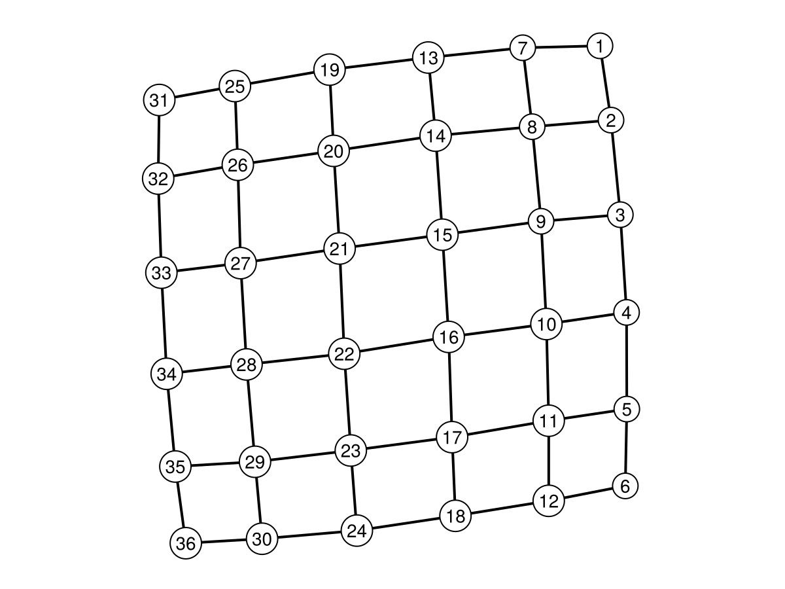
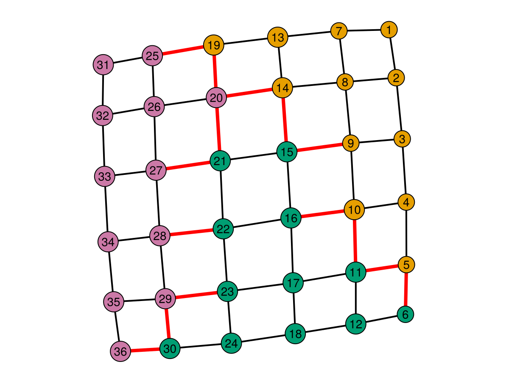
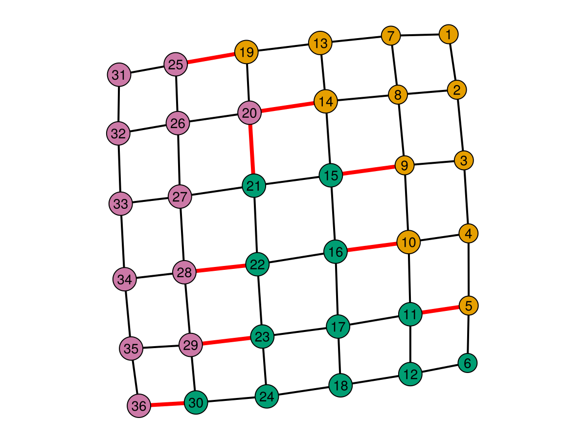
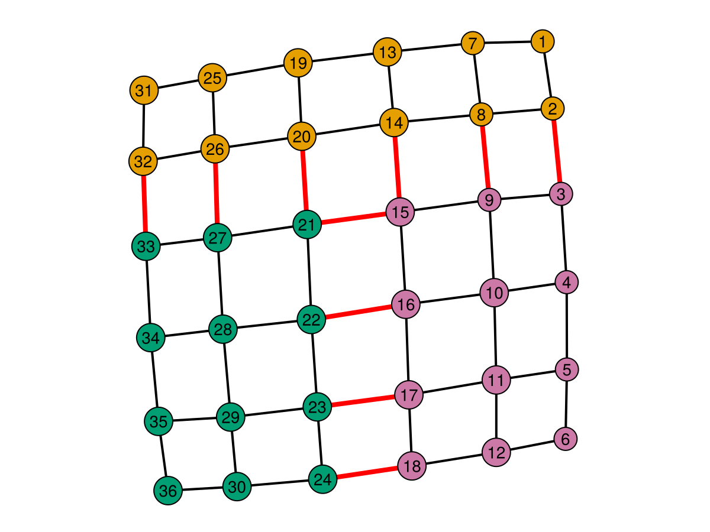

# QuantumHamlets
README under construction: more tutorials and, much better documentation coming by end of August 2026! Please feel free to email us questions if you would like to use this library and the current state of documentation is stopping you. 

## Citing
If you would like to cite this work, please cite our paper: https://arxiv.org/abs/2603.06387

```bibtex
@misc{micciche2026quantumhamletsdistributedcompilation,
      title={Quantum Hamlets: Distributed Compilation of Large Algorithmic Graph States}, 
      author={Anthony Micciche and Naphan Benchasattabuse and Andrew McGregor and Michal Hajdušek and Rodney Van Meter and Stefan Krastanov},
      year={2026},
      eprint={2603.06387},
      archivePrefix={arXiv},
      primaryClass={quant-ph},
      url={https://arxiv.org/abs/2603.06387}, 
}
```
## For a non-quantum user, interested in regular graph partitioning for other applications
Our paper, "Quantum Hamlets: Distributed Compilation of Large Algorithmic Graph States", looks at partioning certain classes of quantum states that can be represented as graphs for use in distributed quantum computing.

In that context, rather than minimizing edges cut, it is better to minimize the sizes of the maximum matching sizes that cross the partitions (for the purpose of reducing the amount of long range quantum entanglement needed).

In this pursuit, we developed a new heuristic algorithm for partitioning graphs with this goal in mind. To our knowledge, we were the first to consider this problem of graph paritioning with matchings as the objective, and the NP hardness proof is also present in our paper. 

We hope that our abstractions were clear enough that Example 1 below is shows you how to use our heuristic, BURY.

## For a user interested in quantum graph state partitioning

## Example 1: Partitioning a Grid into $k$ pieces
First, we need to define how many hamlets ($k$) and villagers per hamlet ($n/k$) we are considering:
```julia
numHamlets = 3
villagersPerHamlet = 12
n = numHamlets * villagersPerHamlet
```
We also need a graph to consider:
```julia
using Graphs
g = grid([6,6])
```
QuantumHamlets.jl has a simple built in plotting function for graphs. Most of its functionality is for visualizing partitions, but it works just as well for looking a unpartitioned graphs. It is internally called with more parameters by `visualize_graph_on_land`, which shows up later in this example.
```julia
using QuantumHamlets
QuantumHamlets.print_graph(g)
```

Now we need to create a "registry of villagers". That is, a dictionary that takes integers from 1 to $n$, and maps each to one of the $k$ hamlets. QuantumHamlets.jl has a few different partition methods to choose from and all will return this "registry". Here is how one would use the BURY algorithm from our paper:
```julia
bury_reg = QuantumHamlets.bury_k(g, numHamlets)
```

Now we use this registry to create a `quantumLand` object. This object is used to track 
which villager node is in which hamlet. Admittedly, in the current version of QuantumHamlets (this very well may change in the future!), it doesn't have much more use than to bridge the registry to the other functions in a somewhat nicer structure than a dictionary.
```julia
buryLand = QuantumHamlets.quantumLand(bury_reg, numHamlets, n)
```
Finally, we can visualize the inter-hamlet connections needed to generate a graph state on configuration specified by a `quantumLand` object. This function takes a `quantumLand` object, a graph, and a function to evaluate the cost of the partitioning. A few are implemented in QuantumHamlets.jl:
- `naive_cost_of_partition`*
- `matching_cost_of_partition`*
- `cut_rank_cost` (currently in resources/sandbox.jl file)
- `vertex_cover_cost_of_partition`

*While all of the methods can compute costs, only starred ones can be used for visualization by `visualize_graph_on_land`. These two return a list of colored edges as a second argument which is needed by that function.
```julia
f_bury, bury_cost = QuantumHamlets.visualize_graph_on_land(buryLand, g, method=QuantumHamlets.naive_cost_of_partition)
f_bury
```

The `bury_cost` variable here is equal to the number of highlighted edges, which is 15 in this case. `naive_cost_of_partition` simply counts and highlights the total number of cut edges, a metric that our paper argues is quite suboptimal for *graph state* partitioning. Furthermore, BURY is designed to perform well on minimizing the matching sizes that cross the cuts. Here is how we visualize that:
```julia
f_bury, bury_cost = QuantumHamlets.visualize_graph_on_land(buryLand, g, method=QuantumHamlets.matching_cost_of_partition)
f_bury
```

Now `bury_cost` is equal to 9, and as we describe in the paper, this corresponds to being able to couple villager qubits to their mayors and perform $Y$ measurements in order to generate the same desired graph state. The cost here is the number of entanglements needed between hamlets (QPUs). This cost is also equal to sum of the sizes of the maximum matchings between each pair of hamlets.

For comparison, out of all existing methods, we found Metis to be most competitive. Here is how this graph compares against Metis:
```julia
using Metis
metis_reg = Dict()
metis_part = Metis.partition(g,numHamlets)
for a in eachindex(metis_part)
    metis_reg[a] = metis_part[a]
end

metisLand = QuantumHamlets.quantumLand(metis_reg, numHamlets, n)
f_metis, metis_cost = QuantumHamlets.visualize_graph_on_land(metisLand, g, method=QuantumHamlets.matching_cost_of_partition)
f_metis
```

`metis_cost` here is equal to 10. Notice that using Metis would give a better performance on cut edges (by visual inspection - we calculated the matching sizes), however, BURY performs better at reducing the matching sizes across the cuts. 