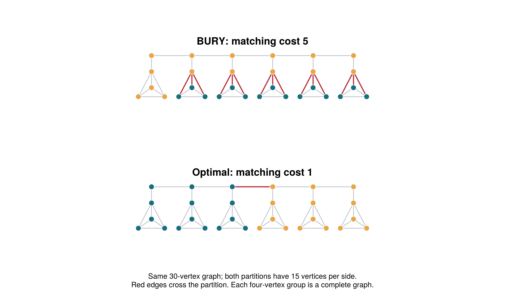

# Approximation guarantees for BURY

## Main result

For **maximum matching cost and an exactly balanced bipartition**, the current BURY algorithm has **no constant approximation factor**. There is an explicit family of connected planar graphs of maximum degree four on which the optimum is one but every BURY run costs at least `ceil(n/6)`. The result covers ordinary BURY, every explicit seed, exhaustive and sampled seed search, every vertex labeling, and all three equivalent backends.

Two positive results remain useful:

- A small component-packing modification gives a **2-approximation on graphs of maximum degree at most two**.
- A separator-search wrapper gives **rigorous instance-specific approximation certificates**, repairs every nonempty instance with optimum zero or one when its search cap is one, and never worsens ordinary BURY's matching cost. A fixed cap does not give a constant guarantee on arbitrary graphs.

The proofs below concern a single bipartition. The negative result already rules out a universal guarantee for the multipartition API because that API includes two parts. The positive results do not establish an approximation factor for the sum of pairwise matchings with three or more parts. All implementation additions are separate [archived research prototypes](../archive/README.md#bury-approximation); production code is unchanged by this study.

## Objective and selection rule

Let `G=(V,E)` be a simple undirected unweighted graph. For a target size `R`, a feasible partition has a colored side `A` with `|A|=R`. Write

\[
\mu(A)=\nu\bigl(G[A,V\setminus A]\bigr),\qquad
\mathrm{OPT}_R=\min_{|A|=R}\mu(A),
\]

where `ν` is maximum matching cardinality. Exact bisection means `R=n/2`, with even `n`. A constant approximation would require `μ(A_BURY) ≤ C OPT_R` for an absolute constant `C`, independent of graph size and vertex labels. In particular, it must return zero when the optimum is zero. The counterexample below has optimum **one**, so it does not exploit that boundary case.

For every unprocessed candidate `v`, the implemented BURY weight is

\[
w(v)=|N[v]\setminus A|.
\]

This identity follows from initializing at `degree(v)+1` and decrementing once for each newly colored vertex in its closed neighborhood. BURY chooses the eligible vertex of least weight, resolving ties by vertex ID. If its remaining budget can pay `w(v)`, it colors the whole closed neighborhood; otherwise it attempts to color `v` alone. A colored vertex stays eligible until it is itself selected. Seeded BURY restricts selection to its growing region, with a global fallback when that region is exhausted.

The counterexample's important prefix consists entirely of affordable neighborhood purchases. Therefore, during that prefix, the remaining budget is exactly `R−|A|`; the proof does not assume that identity after an unaffordable singleton attempt.

## A counterexample that defeats every seed

### Construction

Choose an integer `r≥3`.

1. Form a path of `2r` vertices, called hubs: `h₁,…,h₂ᵣ`.
2. For each hub `hᵢ`, add a separate complete graph `Cᵢ≅K₄`.
3. Choose one vertex `cᵢ` of each clique and add the edge `hᵢcᵢ`. Call `cᵢ` its connector.

There are `n=10r` vertices, and the target is `R=5r`. Hubs have degree at most three, clique connectors have degree four, and other clique vertices have degree three. Thus the maximum degree is four. The graph is planar: each `K₄` is planar, and the added path and attachment edges are bridges between separate pieces.

The first `r` hubs together with their cliques contain exactly `5r` vertices. Separating them from the other half cuts only `hᵣhᵣ₊₁`. This partition has matching cost one. Every nontrivial cut of a connected graph has a crossing edge, so

\[
\boxed{\mathrm{OPT}_{5r}=1.}
\]



### Why BURY colors the backbone first

Ordinary BURY starts at an endpoint hub: its initial price is three, below the price four or five of every clique vertex. For seeded BURY, inspect the three possible seed locations:

- A hub seed permits hubs and its connector; a hub has the least price.
- A nonconnector clique seed permits only its clique; the first choice colors that entire clique.
- A connector seed permits its hub and clique. A least-price choice either starts hub expansion or colors that one entire clique.

If a clique is filled first, its nonconnector candidates have price zero and its connector has price one. After the harmless zero-price choices, the connector colors its hub. Thus every run begins hub expansion, possibly after filling **one** clique.

During expansion, the colored hubs form an interval on the path. Until the backbone is exhausted, an eligible unprocessed hub at its frontier has residual price at most two: its own vertex and either its predecessor hub or its initially filled connector are already colored. Once all hubs are colored, any remaining unprocessed hub has price at most one. A newly selected hub may occasionally be an uncolored adjacent endpoint tied at price two; that only extends the interval.

In every other clique, only its connector can have been colored. Its connector and interior candidates therefore have residual price at least three. Consequently, hub expansion wins every relevant comparison, regardless of vertex IDs. In seeded BURY, the frontier hub is eligible because it was included in the preceding neighborhood; region restrictions do not prevent this expansion.

All these neighborhood purchases fit. Their union lies in the set consisting of all hubs, all connectors, and at most three extra vertices of the initially filled clique. This set has size at most

\[
4r+3\le 5r=R.
\]

Inductively, the next such neighborhood costs no more than the remaining budget. If the algorithm terminates during this prefix, its target can be reached only after all hubs and connectors have been colored. Otherwise it completes this prefix before coloring more clique interiors. Either way, **every final output contains all `2r` hubs and all `2r` connectors**.

### Counting the unavoidable crossing matching

The target is `5r`. Once the `4r` hubs and connectors are included, only `r` extra clique vertices can be included. Completing a clique requires three extra vertices. Hence at most `floor(r/3)` cliques can be completely colored, and at least

\[
P\ge 2r-\lfloor r/3\rfloor
 =\lceil 5r/3\rceil
 =\lceil n/6\rceil
\]

are split. Every split clique contains a crossing edge. Taking one such edge from each split clique gives a matching, since different cliques have disjoint vertices. Therefore

\[
\boxed{\frac{\mu(A_{\mathrm{BURY}})}{\mathrm{OPT}_{5r}}
\ge\lceil n/6\rceil.}
\]

The ratio diverges. This proves the failure of every constant factor for current ordinary and seeded BURY. Since **every** seed fails, exhaustive seed search, sampled seed search, and relabeling cannot remove the obstruction. `partition_graph(g,2)` and its seeded variant inherit it from their first partitioning round. Heap, scan, and legacy implement the same choices and have the same obstruction.

For completeness, the crossing graph is a disjoint union of the complete bipartite cuts inside the split cliques. Each such block has GF(2) rank one and at least three edges. Thus the same family gives rank at least `ceil(n/6)` and edge cut at least `3ceil(n/6)`, while each corresponding optimum is also one. These are separate objective-specific statements, not an assumption that the objectives are interchangeable.

### What the counterexample says about modifications

The failure is not caused by the backend or an unlucky seed. The local price rewards a cheap backbone that touches many different cliques. Exact balance then forces those cliques to remain split. A useful modification must address the global separation or packing decision. Merely changing minimum-selection data structures, trying more seeds, or randomizing vertex IDs preserves this example's obstruction.

## A modification with provable matching certificates

The following characterization gives an exact test for whether a cheap matching cut exists.

**Theorem.** `OPT_R` equals the smallest size of a vertex set `S` for which the connected components of `G−S` have a subset with total size `t` satisfying

\[
\max(0,R-|S|)\le t\le R.
\]

**Proof.** Given an optimal partition, its crossing graph is bipartite. By König's matching–vertex-cover theorem, its edges have a vertex cover `S` of size `OPT_R`. Deleting `S` removes every crossing edge, so every remaining connected component lies entirely on one side. The components on the target side total `t=|A\S|`, in the stated interval.

Conversely, take a qualifying union of components of size `t`, and add any `R−t` vertices of `S`. This forms a side of exactly `R` vertices. Every crossing edge meets `S`, so every crossing matching has at most `|S|` edges. The two inequalities establish equality. ∎

### The experimental wrapper

The [archived certified prototype](../archive/README.md#bury-approximation), at `experiments/bury_approximation/certified/certified_bury.jl` after restoration, first obtains BURY's matching cost `U`. If `U=0`, it is optimal. Otherwise it enumerates vertex sets in increasing size through

\[
q'=\min(q,U-1),
\]

using component sizes and a subset-sum dynamic program for each set.

- The first successful size `s` gives an **optimal** partition: smaller sizes were exhaustively ruled out, and the construction has cost at most `s`.
- If all searches fail, the theorem proves `OPT_R≥q'+1`. Keeping BURY's original partition gives the certificate

\[
\boxed{\mu(A)/\mathrm{OPT}_R\le U/(q'+1).}
\]

This never worsens BURY's matching cost. With `q=0`, it repairs every zero-optimum input. With `q=1`, it additionally solves every optimum-one input, including the entire counterexample family above. For example, the measured 80-vertex instance improves from matching cost **14 to 1**. The prototype requires an integer cap in `0:n`; use `max_cover=0` for an empty graph.

Restore the approximation study and its required context as described in the
[archive index](../archive/README.md#bury-approximation), then run this example
from the restored package root:

```julia
include("experiments/bury_approximation/certified/certified_bury.jl")
using .CertifiedBury

result = certified_bury(g, nv(g) ÷ 2; max_cover=1)
result.partition
result.cost
result.lower_bound
result.factor
result.optimal
```

The integer upper and lower bounds are the mathematical certificate; `factor` is a floating-point display of their quotient. A factor of two is proved whenever `U≤2(q'+1)`. Failure to establish that inequality is an uncertified result, not evidence that BURY is necessarily worse than a factor of two.

The separator-search work is bounded by

\[
O\!\left(\sum_{s=0}^{q'}\binom ns\,(n+m+nR)\right).
\]

The wrapper additionally runs BURY and evaluates at most two matching costs. The separator search is polynomial for a fixed cap, but can be costly even at a small cap on large inputs. A fixed cap does **not** yield a universal constant approximation. To force a requested factor `C≥1`, one can search through `q=ceil(U/C)−1`; the preceding proof then gives that factor or an exact optimum. However, `q` can grow with `n`, making this an exponential-time guarantee. It does not solve the general polynomial-time approximation problem.

## A genuine factor two on graphs of maximum degree two

Consider this simpler modification: first try to form exactly `R` vertices from whole connected components. If possible, return that zero-cost cut; otherwise run ordinary or seeded BURY. The prototype exposes it as `component_guarded_bury(g,R; seed=nothing,backend=:heap)`.

**Theorem.** On graphs with maximum degree at most two, this algorithm is a 2-approximation for matching cost, for any target `R`, including disconnected graphs and zero-optimum cases.

**Proof.** Every component is a path, a cycle, or an isolated vertex. Once BURY buys a full neighborhood in a nontrivial component, its colored vertices form an interval. An unprocessed colored boundary candidate has residual price at most one, so it expands this interval before starting another nontrivial component, whose minimum price is at least two. Isolated vertices can interleave harmlessly. Seeded selection retains the interval boundary in its region. Thus completed components contribute no crossing edges, and at most one component is partially colored.

If the remaining budget cannot buy the initial neighborhood, at most two vertices remain to be colored. A singleton or two adjacent vertices in a path or cycle still gives at most two crossing edges; after the first singleton, its eligible neighbor has smaller price than unrelated cycle vertices. Therefore every resulting cut has at most two crossing edges, and matching cost at most two.

The prepass finds every zero-cost partition, since a zero crossing matching is equivalent to having no crossing edges, hence to packing whole components. If the prepass fails, the integral optimum is at least one. The output therefore costs at most `2 OPT_R`. ∎

The same proof gives a factor two for edge count and cut rank on this restricted class. The class consists only of paths, cycles, isolated vertices, and their disjoint unions; this guarantee does not cover general grids or the GraphML workloads.

## Why the general goal needs more than a local tweak

For every cut in a graph of maximum degree `Δ`, its crossing graph is bipartite and satisfies

\[
\nu_{\mathrm{cut}}\le |E_{\mathrm{cut}}|
\le\Delta\nu_{\mathrm{cut}}.
\]

The second inequality follows by covering all crossing edges with a minimum vertex cover of size `ν_cut`, with at most `Δ` incident edges per cover vertex. Consequently, any universal matching `C`-approximation would give a `3C`-approximation for edge minimum bisection on cubic graphs. Berman and Karpinski show that a constant approximation on cubic graphs would imply one for general minimum bisection. This is a consequence of their stated reduction, not a claim that NP-hardness by itself rules out approximation. [Berman and Karpinski, Approximation Hardness of Bounded Degree MIN-CSP and MIN-BISECTION](https://eccc.weizmann.ac.il/report/2001/026/).

The explicit BURY counterexample is unconditional and does not rely on any complexity conjecture. It rules out the desired theorem for this greedy rule, while leaving open the design of a different algorithm or a stronger guarantee under useful structural assumptions.

For this library, the practical next step is to retain BURY as a fast candidate generator and expose an optional bounded certificate/repair pass. Keep the lower bound and proof status visible. A separate research direction is to identify graph classes closer to the application workloads on which a constant guarantee can actually be proved.

## Tests and reproducibility

The [complete study archive](../archive/README.md#bury-approximation) contains constructors, standalone prototypes, independent tiny-instance oracles, and saved logs. The mathematical proofs cover the infinite families; finite checks confirm that the proof's selection invariants match the implemented algorithm.

| Check | Scope | Result |
| --- | --- | --- |
| Counterexample | Eleven instances with clique sizes 4, 5, and 6; every seed, original labeling and two random relabelings; ordinary backend equivalence and representative seeded equivalence | 12,861 passing assertions |
| Matching certificate | Every labeled simple graph through five vertices and every target, plus 80 deterministic random six/eight-vertex instances; independent enumeration of cuts and matchings | 158,654 passing assertions |
| Degree two bound | Every labeled graph of maximum degree two through six vertices, every target and explicit seed | 202,652 passing assertions over 101,326 partitions |
| Modification integration | Component packing, validation, ordinary/seeded fallback, and repair of 30-, 40-, and 80-vertex counterexamples | 156 passing assertions |

Representative degree-four counterexamples, using the constructor's labeling:

| Vertices | BURY matching | Minimum over every explicit seed | Optimal matching | Certificate wrapper with cap one |
| ---: | ---: | ---: | ---: | ---: |
| 30 | 5 | 5 | 1 | 1 |
| 40 | 8 | 8 | 1 | 1 |
| 80 | 14 | 14 | 1 | 1 |

The tests use the current package and Julia 1.12.6. They do not rerun the large GraphML or research sweeps. Existing production source, package tests, and historical experiment results were left unchanged.
