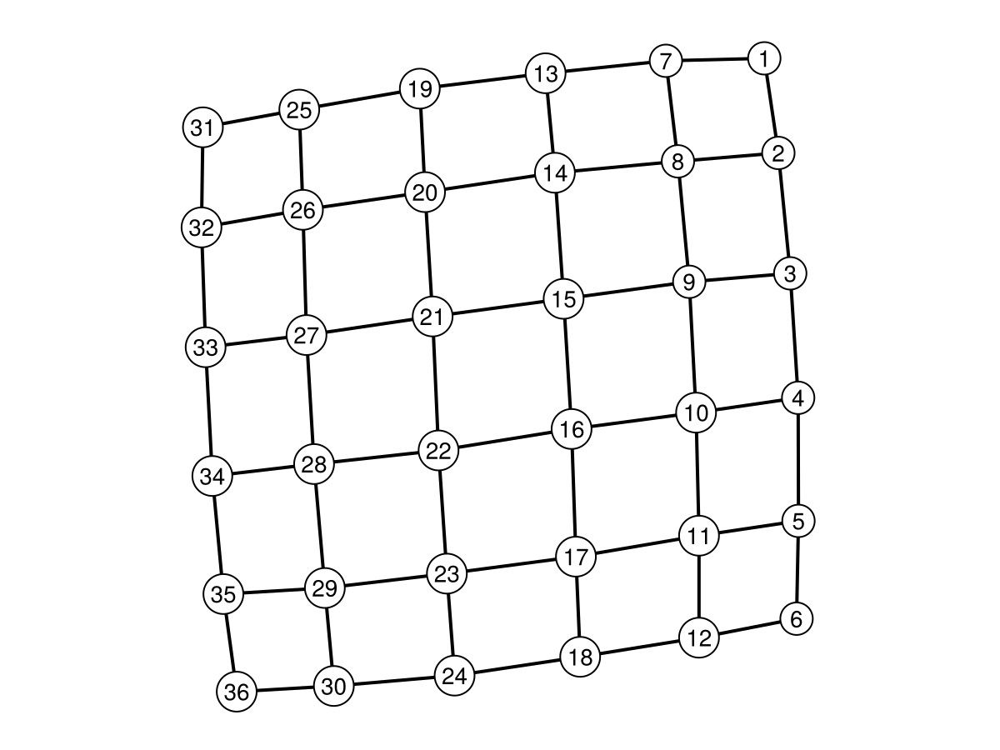
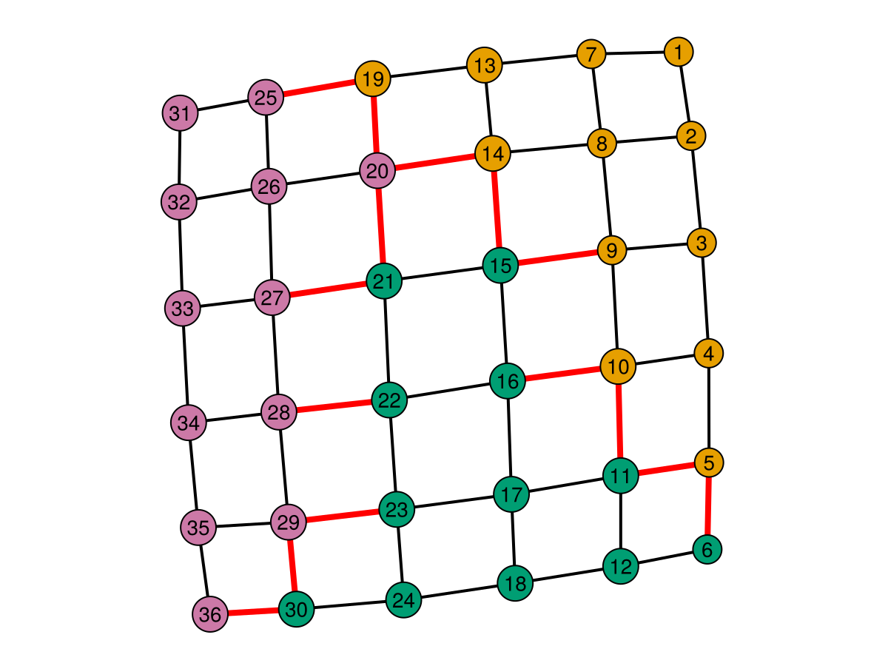
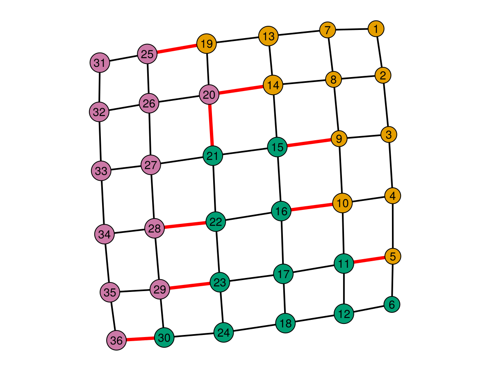
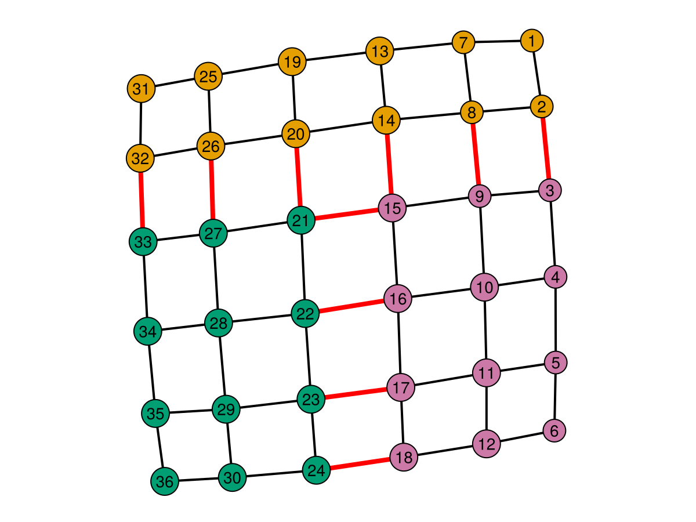

# Using QuantumHamlets.jl

The numerical workflow is to construct a graph, assign its vertices to partitions, and evaluate a cost. Visualization is optional. BURY uses the heap backend by default; the original qualified BURY function names still work and accept an explicit backend.

## Graphs and partition membership

```julia
using Graphs, QuantumHamlets

g = grid([6, 6])
p = partition_graph(g, 3)
partition_sizes(p)  # [12, 12, 12]
```

The supported graph input is a simple undirected `Graphs.Graph` with vertices numbered `1:nv(g)`. `partition_graph(g, k)` requires a nonempty graph, `1 ≤ k ≤ nv(g)`, and exact divisibility of `nv(g)` by `k`. It returns a `GraphPartition` rather than a dictionary or a tuple with algorithm metadata.

The algorithm is selected with a keyword:

| Call | Implementation |
| --- | --- |
| `partition_graph(g, k)` | BURY, equivalent to `algorithm=:bury, backend=:heap` |
| `partition_graph(g, k; algorithm=:bury_seeded)` | Seeded multipartition BURY using the existing minimum-weight seed rule |
| `partition_graph(g, k; algorithm=:random)` | Balanced random assignment using Julia's default RNG |
| `partition_graph(g, k; algorithm=:saran_vazirani)` | The existing Saran–Vazirani baseline, including its optimization solver |

`verbose=true` forwards BURY's progress output. The random method retains the existing default-RNG behavior and has no `rng` keyword. Use `Random.seed!(seed)` before a call when reproducing a run in the same Julia environment. The Saran–Vazirani baseline is experimental; the new interface raises an error if it returns an incomplete assignment.

### Choose a BURY backend

The algorithm determines the partitioning procedure; the backend determines how BURY selects and updates its candidates:

| Backend | Implementation and intended use |
| --- | --- |
| `:heap` (default) | Indexed minimum heaps; generally strongest on larger sparse graphs |
| `:scan` | Minimum scans with incremental colored counts and fewer temporary arrays; useful for small or dense inputs and many small seeded workloads |
| `:legacy` | Original ordinary and seeded implementations, retained for compatibility and reference comparisons |

```julia
p = partition_graph(g, 3; backend=:heap)
p = partition_graph(g, 3; backend=:scan)
p = partition_graph(g, 3; backend=:legacy)
p = partition_graph(g, 3; algorithm=:bury_seeded, backend=:scan)
```

Backend selection preserves the greedy rule, smallest-vertex-ID ties, and seeded-region behavior. There is no automatic density threshold: graph size, target size, degree distribution, and seed can all change which backend is fastest. The [GraphML measurements](graphml_backend_findings.md) and [per-graph guide](../experiments/graphml_bury/per_graph_guide.md) give examples.

`backend` applies to BURY. The `:random` and `:saran_vazirani` algorithms accept the default `backend=:heap` without using it; explicitly requesting `:scan` or `:legacy` with either raises `ArgumentError`. An unknown backend name also raises `ArgumentError`.

The original qualified BURY calls accept the same keyword:

```julia
const Q = QuantumHamlets
reg, colored = Q.bury(g, nv(g) ÷ 2; backend=:scan)
reg, colored = Q.bury_seeded(g, nv(g) ÷ 2, 1; backend=:heap)
reg = Q.bury_k(g, 3; backend=:legacy)
reg = Q.bury_k_seeded(g, 3; backend=:scan)
```

These functions retain their existing registry and tuple returns: `bury` and `bury_seeded` return `(Dict{Any,Any}, Vector{Bool})`, and the multipartition functions return `Dict{Any,Any}`. A colored vertex receives label 2 in a single bipartition. `verbose=true` retains the original trace for supported integer inputs on every backend.

Omitting the positional seed in `Q.bury_seeded(g, target; backend=...)` runs the existing sampled automatic seed search using that backend for every candidate and the final partition. Candidate order, repeated sampled seeds, matching scoring, and RNG consumption are preserved. `Q.best_seed` and `Q.best_sqrt_seed` also accept `backend`; switching it does not change their seed-selection policy. Multipartition calls carry the backend through every part. Seeded multipartition calls retain their deterministic minimum-weight seed rule.

`Q.bury_not_balanced_bipartition(g, min_v, max_v; backend=:scan)` uses scan for every target in the inclusive range. If `bury_v` is the built-in `Q.bury` or `Q.bury_seeded`, the keyword is forwarded. A custom `bury_v(graph, target)` callback keeps its two-argument calling convention and controls its own backend:

```julia
custom = (graph, target) -> Q.bury(graph, target; backend=:scan)
reg, colored = Q.bury_not_balanced_bipartition(g, 10, 18; bury_v=custom)
```

Use integer single-partition targets in `0:nv(g)` and explicit seeds in `1:nv(g)`. Heap and scan reject unsupported targets and seeds with `ArgumentError`; legacy keeps its original input behavior, including the oversized-target limitation below. The balanced `partition_graph` interface validates `k` before calling a backend.

### Supply your own partition

A membership vector gives the partition label for each vertex. A dictionary maps vertex IDs to labels:

```julia
p = GraphPartition([1, 1, 2, 2])
p_from_dict = GraphPartition(Dict(1 => 1, 2 => 1, 3 => 2, 4 => 2))

membership(p)       # [1, 1, 2, 2]
registry(p)         # Dict(1 => 1, 2 => 1, 3 => 2, 4 => 2), in arbitrary order
partition_sizes(p)  # [2, 2]
length(p)           # 4
```

Labels must be integers in `1:nparts`, and dictionaries must contain exactly the vertex keys `1:n`. The partition count defaults to the largest label, or to one for empty membership. Specify `nparts` to represent empty parts:

```julia
p = GraphPartition([1, 1, 3, 3]; nparts=3)
partition_sizes(p)  # [2, 0, 2]
```

Unlike balanced partition generation, a supplied partition may be uneven or contain empty parts. Cost evaluation checks that its membership length matches the graph's vertex count.

Constructors copy their input. `membership(p)` and `registry(p)` also return copies, so changing either result does not change `p`. Treat the object's fields as internal and read-only; construct a new `GraphPartition` to change an assignment. This avoids synchronizing the separate villager and hamlet structures used by the original API.

## Numerical costs

All scalar cost calls take the graph first and partition second:

| Function | Result and meaning |
| --- | --- |
| `edge_cut_cost(g, p)` | Integer number of edges whose endpoints have different partition labels |
| `matching_cost(g, p)` | Integer sum of maximum matching sizes over unordered pairs of partitions |
| `pairwise_cut_rank(g, p)` | Integer sum of GF(2) biadjacency ranks over unordered pairs of partitions |
| `vertex_cover_costs(g, p)` | Named tuple `(ghz_free=..., ghz_n_minus_one=...)` calculated from the existing greedy vertex cover |

The matching and rank values are exact for a fixed partition and their stated objectives. BURY is a heuristic for selecting the partition; it does not guarantee an optimal assignment. The cover routine uses a greedy cover, so its two estimates need not be minimum costs.

Matching and rank are different objectives. A complete bipartite graph with two vertices on each side illustrates the distinction:

```julia
g = complete_bipartite_graph(2, 2)
p = GraphPartition([1, 1, 2, 2])
edge_cut_cost(g, p)     # 4
matching_cost(g, p)     # 2
pairwise_cut_rank(g, p) # 1
```

For more than two partitions, `pairwise_cut_rank` is a sum over pairs, not one bipartite cut rank. The physical interpretation of each objective depends on the preparation model; see the [paper](https://arxiv.org/abs/2603.06387) for those assumptions.

### Inspect the matching edges

```julia
details = matching_details(g, p)
details.cost   # 2
details.edges  # matching edges with the original graph's vertex IDs
```

The result has named fields `cost` and `edges`. These edges form a valid maximum matching within each pair of partitions. A vertex may occur in matchings for several different pairs, so their union need not be one global matching. Different maximum matchings can have the same cost.

## Visualization

```julia
g = grid([6, 6])
p = partition_graph(g, 3)

figure, cost = plot_partition(g, p; highlight=:matching)
figure
```

`plot_partition` returns `(figure, cost)`. Nodes are colored by partition; the highlight controls the edge overlay:

| Highlight | Overlay | Returned cost |
| --- | --- | --- |
| `:matching` (default) | Pairwise matching edges | `matching_cost(g, p)` |
| `:cut_edges` | All cross-partition edges | `edge_cut_cost(g, p)` |
| `:none` | No edge overlay | `nothing` |

Use `highlight=:none` to display membership while reporting a rank or cover estimate separately. Save a figure with the plotting backend:

```julia
using CairoMakie
save("partition.png", figure)
```

The plotting dependencies still load with the package in this revision. Separating them into an optional extension is future work.

For the 6×6 grid example, all three BURY backends produce three groups of 12 vertices. The cut-edge score is 15 and the matching score is 9:







These figures are the original example assets. They illustrate one graph and partition, not a general performance guarantee.

## Existing API and migration

The original API remains available through `QuantumHamlets`. Existing registries, tuple returns, and `quantumLand` constructors have not been replaced. Its BURY calls now default to heap; add `backend=:legacy` to request the original implementation. A calculation with the original API can still be written as:

```julia
using Graphs, QuantumHamlets
const Q = QuantumHamlets

g = grid([6, 6])
reg = Q.bury_k(g, 3)
land = Q.quantumLand(reg, 3, nv(g))
cost, edge_colors = Q.matching_cost_of_partition(land, g)
figure, cost = Q.visualize_graph_on_land(
    land, g; method=Q.matching_cost_of_partition
)
```

Use the conversion methods when integrating new code with existing scripts:

```julia
p = GraphPartition(land)
new_land = Q.quantumLand(p)
reg = registry(p)
```

| Original expression | Simpler interface |
| --- | --- |
| `Q.bury_k(g, k)` | `partition_graph(g, k)` |
| `Q.bury_k_seeded(g, k)` | `partition_graph(g, k; algorithm=:bury_seeded)` |
| `Q.k_partition_random(g, k)` | `partition_graph(g, k; algorithm=:random)` |
| `Q.quantumLand(reg, k, nv(g))` | `GraphPartition(reg; nparts=k)` |
| `first(Q.naive_cost_of_partition(land, g))` | `edge_cut_cost(g, p)` |
| `first(Q.matching_cost_of_partition(land, g))` | `matching_cost(g, p)` |
| `first(Q.cut_rank_cost(land, g))` | `pairwise_cut_rank(g, p)` |
| `Q.vertex_cover_cost_of_partition(land, g)` | `vertex_cover_costs(g, p)` with named fields |
| `Q.visualize_graph_on_land(land, g; method=Q.matching_cost_of_partition)` | `plot_partition(g, p; highlight=:matching)` |

The original cost functions keep their return formats: edge-cut and matching return `(cost, edge_colors)`, rank returns `(cost, nothing)`, and cover returns two numerical costs. In particular, the cover tuple is not a score plus plotting colors. The new plotting interface uses explicit overlays instead of accepting an arbitrary cost function.

The simpler interface adds input checks at its boundary. Known algorithm and cost defects remain relevant regardless of the selected BURY backend.

### Compare an external partitioner

Metis is an example dependency, not a QuantumHamlets dependency. Install it in an environment that also develops this checkout, then convert its labels directly:

```julia
using Graphs, QuantumHamlets, Metis

g = grid([6, 6])
bury = partition_graph(g, 3)
metis = GraphPartition(Metis.partition(g, 3); nparts=3)

matching_cost(g, bury)
matching_cost(g, metis)
```

Use the same objective for both algorithms, and inspect `partition_sizes` when comparing their balance. External partitioners can vary with their version or random choices. The original METIS example figure is retained here:



## Tests and source organization

Run the suite from the package directory:

```sh
julia --project=. -e 'using Pkg; Pkg.test()'
```

The tests cover deterministic fixtures, exhaustive small graphs, valid partition sizes, numerical costs, input graph preservation, conversions, and equivalence against a frozen original BURY implementation. Backend checks also cover automatic seed selection, RNG consumption, custom callbacks, return types, and verbose traces. Known failures use `@test_broken` with explanatory comments. When one is fixed, change its assertion to `@test`; an unexpected pass is deliberately reported so the known-failure list cannot silently become stale. The legacy oversized-target hang is not invoked in the ordinary test process.

The source is organized within one module:

| File | Responsibility |
| --- | --- |
| `src/QuantumHamlets.jl` | Imports, exported API, and includes |
| `src/quantum_land.jl` | Original villagers, hamlets, and `quantumLand` representation |
| `src/graph_utils.jl` | Graph and vertex-map helpers |
| `src/bury.jl` | Public BURY wrappers, backend selection, multipartitioning, and seed searches |
| `src/bury/heap.jl` | Indexed-heap color kernel |
| `src/bury/scan.jl` | Optimized scan color kernel |
| `src/bury/legacy.jl` | Original ordinary and seeded implementations |
| `src/baselines.jl` | Random and Saran–Vazirani partitioning |
| `src/costs.jl` | Original cost implementations |
| `src/visualization.jl` | Original graph plotting |
| `src/display.jl` | Original text display methods |
| `src/partition.jl` | `GraphPartition` and conversions |
| `src/api.jl` | Simpler partition, cost, details, and plotting calls |

Research scripts and data remain under `resources/`. The [revision proposal](revision_proposal.md) describes follow-up work, including performance measurements and separate example/experiment environments.

## Known limitations

The backend change preserves BURY's supported-input choices and the existing scoring and seed policies. Broader bug fixes remain a separate task. In particular:

- Matching evaluation with only one declared partition still raises an error; this also affects `matching_cost`, `matching_details`, and the matching plot overlay.
- With `backend=:legacy`, `bury` and `bury_seeded` retain the original incomplete target validation: a target greater than the number of vertices can hang. Heap and scan reject invalid targets; use integer targets between zero and `nv(g)` for every backend.
- `bury_not_balanced_bipartition` can return no candidate when the supplied objective exceeds its initial bound.
- The original Saran–Vazirani baseline returns an incomplete registry for an edgeless graph. `partition_graph` reports that failure instead of constructing an incomplete partition.
- Original `quantumLand` objects can retain an input dictionary by reference, and their text display methods ignore the requested output stream. The new partition constructor copies its input; this does not change legacy object behavior.
- Some research comparison scripts still consume the old cost tuples incorrectly. They are not the runnable quickstart and are left for the later bug-fix pass.

See the regression tests and [review findings](revision_proposal.md#confirmed-defects-and-regression-targets) for concrete cases.
